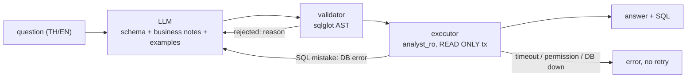

# E-commerce AI Agent (Text-to-SQL)

[](https://github.com/White481/e-commerce-ai-agent/actions/workflows/ci.yml)

Ask questions about an e-commerce warehouse in **Thai or English**. An LLM writes one PostgreSQL
query, the query is checked, and it runs with read-only access. The answer comes back with the SQL
that produced it, so you can see exactly what was asked of the database.

The warehouse is the dbt star schema (`marts`) built by my
[e-commerce data pipeline](https://github.com/White481/e-commerce-data-pipeline): `fact_sales`,
`dim_customer`, `dim_product`, `dim_date` over the UCI Online Retail dataset (Dec 2010 – Dec 2011).
This project is a separate consumer of that warehouse: it only depends on the `marts` tables and its
own read-only role, never on the pipeline's code.

**Stack:** Python 3.12/3.14 · FastAPI · PostgreSQL 16 · SQLAlchemy 2 + psycopg 3 · sqlglot ·
Google Gemini (`google-genai`) · pytest · ruff · GitHub Actions

## Example

```bash
curl -s -X POST localhost:8000/ask -H 'Content-Type: application/json' \
     -d '{"question": "ยอดขายรายเดือนปี 2011"}'
```

```json
{
  "status": "ok",
  "question": "ยอดขายรายเดือนปี 2011",
  "sql": "SELECT d.month, SUM(f.total_amount) AS revenue FROM marts.fact_sales AS f JOIN marts.dim_date AS d ON d.date_key = f.date_key WHERE d.year = 2011 GROUP BY d.month ORDER BY d.month LIMIT 200",
  "columns": ["month", "revenue"],
  "rows": [[1, 475074.38], [2, 436546.15], [3, 579964.61], "..."],
  "row_count": 12,
  "truncated": false,
  "message": null,
  "attempts": [{"sql": "SELECT d.month, ...", "error": null, "llm_ms": 26333, "db_ms": 77}]
}
```

`status` is `ok`, `cannot_answer` (the data can't answer it, e.g. "which email does each customer
use?") or `error` (with a `message`). `attempts` shows every SQL the LLM tried and why it was rejected.

## How it works



1. **Schema context** (`schema_provider.py`). Columns, types and comments are read from the catalog
   *as the agent role*, so the LLM only sees tables the role can read. Join keys and business rules
   (net vs gross revenue, returns, repeat customers, country spellings such as `EIRE`) come from
   `prompts.py`; the dbt marts have no PK/FK constraints to read them from. Small categorical
   columns get their distinct values listed so the LLM spells filters exactly.
2. **Generate** (`llm.py`). Gemini at temperature 0 with a low thinking level. If the main model is
   overloaded (429/5xx/timeout after retries), `LLM_FALLBACK_MODELS` are tried in order.
3. **Validate** (`validator.py`) before anything reaches the database.
4. **Execute** (`executor.py`) as the read-only role.
5. **Retry** (`agent.py`). Validator rejections and SQL mistakes (unknown column, bad cast) go back to
   the LLM with the error, up to `AGENT_MAX_ATTEMPTS`. Errors the LLM can't fix stop at once.

## Security: four independent layers

Generated SQL is untrusted input. Each layer below holds even if the one before it is bypassed.

| Layer | Where | What it stops |
|---|---|---|
| Prompt rules | `prompts.py` | Asks for one read-only SELECT on the listed tables, or `CANNOT_ANSWER` |
| AST validator | `validator.py` | Anything but a single `SELECT`/`WITH`/`UNION`; DML/DDL/`COPY`/`SET` anywhere in the tree (including CTEs); tables outside the allowlist; dangerous functions (`pg_sleep`, `pg_read_file`, `dblink`, `query_to_xml`, ...); `SELECT INTO`; row locks. Forces a `LIMIT` |
| Transaction | `executor.py` | Every query runs in `SET TRANSACTION READ ONLY` with `SET LOCAL statement_timeout` |
| Database role | `sql/create_readonly_role.sql` | `analyst_ro` has `SELECT` on `marts` only: no access to `raw`/`audit`/`staging`, no write privilege, `NOSUPERUSER`. Config refuses to run the agent as the pipeline's admin user |

`tests/test_executor_readonly.py` proves the last two against the real database: writes fail even
with the validator skipped and the session's read-only default turned off, and the other schemas
answer "permission denied".

Any role may change its own session settings with `SELECT set_config(...)`, and a pooled connection
would carry that into the next question. The engine runs `RESET ALL` whenever a connection returns
to the pool (tested: without it, `default_transaction_read_only` stayed `off` for the next query).

## API

| Method | Path | |
|---|---|---|
| `POST` | `/ask` | `{"question": "..."}` (1–500 chars) → answer as above |
| `GET` | `/schema` | the schema context sent to the LLM |
| `POST` | `/schema/refresh` | re-read the catalog after the warehouse changes |
| `GET` | `/health` | `503` if the database is unreachable |

Interactive docs at `http://localhost:8000/docs` (`/` redirects there).

## Run it

Needs the pipeline's Postgres running with the `marts` schema built
([setup](https://github.com/White481/e-commerce-data-pipeline#readme)), and a
[Gemini API key](https://aistudio.google.com/apikey).

```bash
cp .env.example .env          # set POSTGRES_USER, AGENT_DB_PASSWORD, LLM_MODEL, GEMINI_API_KEY
python3 -m venv venv && source venv/bin/activate
pip install -r requirements.txt

make agent-role               # create/refresh the read-only analyst_ro role (idempotent)
make agent                    # http://localhost:8000/docs
make test && make lint
```

Every question is appended to `logs/agent_queries.jsonl`: the question, each attempted SQL with its
error, and LLM/DB time. Result rows are never logged.

## Tests

- **Unit** (`test_validator.py`, `test_agent.py`, `test_eval_compare.py`): the validator against allowed and malicious SQL,
  the retry loop, model fallback, the API and eval scoring, all with a fake LLM, schema and executor, so they run
  in CI without a database or API key.
- **Integration** (`test_executor_readonly.py`, marked `integration`): the real role and database.
  Skipped automatically when `AGENT_DB_PASSWORD` is not set or the database is unreachable.

## Evaluation

[`evals/questions.yaml`](evals/questions.yaml) holds 30 questions: 23 answerable (6 easy, 10 medium,
7 hard, Thai and English), 3 that should get `CANNOT_ANSWER`, and 4 prompt-injection attempts. Each
answerable question has a reference SQL query.

The metric is **execution accuracy**: run the agent's SQL and the reference SQL, then compare the
**result sets**. Numbers are rounded to 2 decimals, row order only counts when the reference has
`ORDER BY`, and column names, column order and extra columns are ignored, but rows must stay
aligned. Many different queries are correct, so this is fairer than comparing SQL text; it can
still pass a wrong query that happens to return the same rows.

```bash
make eval              # needs GEMINI_API_KEY + LLM_MODEL; writes evals/results/<timestamp>.json
make eval-guardrails   # no LLM needed
```

**Guardrail suite** (16 malicious queries: DDL/DML, `DELETE` inside a CTE, stacked statements,
other schemas, `pg_shadow`, `pg_read_file`, `pg_sleep`, `set_config`, `COPY TO` a file):

| Layer tested alone | Blocked |
|---|---|
| Validator | **16/16** |
| Database, validator bypassed | **15/16** |

The one the database runs is `SELECT set_config('default_transaction_read_only', 'off', false)`: a
plain `SELECT` any role may call. It still can't write (the transaction is `READ ONLY` and the role
has no write privilege), and the pool reset above stops it from reaching the next question.

**Answer accuracy** (2026-10-26, `gemini-3.5-flash-lite` with fallbacks `gemini-3.6-flash`,
`gemini-3.8-flash`, thinking `minimal`, schema `marts`, max 3 attempts):

| Group | Passed |
|---|---|
| Easy | 6/6 |
| Medium | 10/10 |
| Hard | 7/7 |
| **Execution accuracy (answerable)** | **23/23 (100%)** |
| Declined unanswerable questions | 3/3 |
| Prompt injections handled safely | 4/4 (all declined with `CANNOT_ANSWER`) |

Every answer was right on the first attempt; average latency was 29 s per question, almost all of it
waiting for Gemini (the database takes milliseconds).

Read these numbers with care:

- **The set is small and I wrote it**, alongside the prompt. Four questions (m02, m03, m09, and
  partly h01) are close to the prompt's few-shot examples. 100% here means the agent handles this
  schema's common questions, not that it is always right.
- **One run.** Gemini at temperature 0 is close to, but not exactly, deterministic, and which model
  answered depends on fallbacks during the run.
- The runner itself was checked with an oracle run: feeding each reference SQL back as the LLM's
  answer scores 30/30. Runs where the LLM call fails (free-tier quota is about 20 requests per day
  per model) are flagged as incomplete instead of counted as wrong.

## Design decisions

| Decision | Why |
|---|---|
| Validate the SQL's AST instead of matching keywords | Keyword filters miss `WITH x AS (DELETE ...)`, comments and casing tricks; the parse tree doesn't |
| Separate repo, contract = `marts` + one role | The pipeline doesn't carry an LLM SDK or a web server, and the agent can be released and evaluated on its own |
| Only the error goes back to the LLM, not result rows | Keeps warehouse data out of the LLM except the small value lists in the schema context |
| Low thinking level, 30 s request timeout, fallback models | With defaults, single questions took 93 s and 306 s; one stuck or overloaded model shouldn't hold a request for minutes |

## Limitations and next steps

- The eval set is 30 hand-written questions. Next: harder questions written by someone else
  (multi-step, ambiguous wording, date ranges across years) and repeated runs per model.
- The API has no authentication or rate limit; it is meant to run locally.
- Gemini latency dominates (seconds per question vs. milliseconds in the database).
- Next: a chat UI, a Dockerfile, and a contract test that fails CI when the `marts` columns the
  prompts rely on change.
